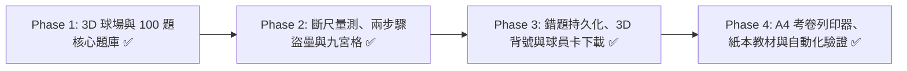

# 國小二年級期中考 3D 棒球複習遊戲：開發計畫書 (Development Plan)

本專案為國小二年級學童（7~8 歲）打造兼具競技快感、蘇格拉底引導式教學與紙本考卷列印的 3D 棒球複習系統，完全託管於 GitHub Pages，支援平板觸控與電腦操作。

---

## 1. 專案範疇與教科書版本鎖定

- **學科 1：國語（康軒版二上，50 題互動題庫 ＋ 紙本講義／模擬卷）**
  - **範圍**：第 1 ~ 6 課（〈新學年新希望〉至〈小鎮的柿餅節〉）及統整活動一、二。
  - **核心考點**：多音字辨析（得、假、教、空、轉、著、背）、形近字挑錯、日/月/肉/竹/米部部件意義、課文理解、短語仿寫與標點符號。
- **學科 2：數學（翰林版二上，50 題互動題庫 ＋ 練習單／模擬卷）**
  - **範圍**：第 1 ~ 5 單元。
  - **核心考點**：200 以內的數（三位數化聚、零的讀寫）、二位數直式進退位加減法、公分測量與殘尺非零起點刻度差、加減兩步驟分步應用題、正方形/長方形幾何特徵。
- **學科 3：生活（跨版本紙本重點整理）**
  - **範圍**：秋天觀察、光與影子、社區生活、校園安全與日常自理。

---

## 2. 系統架構路線圖

---

## 3. 四大開發階段細部里程碑（全數完成 🎉）

### 階段一：MVP 基礎打擊循環與 100 題防洩題題庫【已完成 ✅】
- [x] **3D 棒球場渲染**：程式化建立草皮、紅土菱形、四個壘包、投手丘、外野全壘打牆、看台觀眾與大記分板，支援日/昏/夜三階段動態天色。
- [x] **投打對決與力量槽甜蜜點**：3 大魔王投手、4 種變化球路、動態甜蜜點力量槽與 4 把 3D 神兵球棒商店。
- [x] **讀題鷹架與合成音效**：Web Audio API 合成球棒擊球聲、球場風琴應援曲，搭配 Web Speech API 國語朗讀（多音字自動防洩題）。
- [x] **蘇格拉底三階段引導教學**：第一次答錯判界外球，提供迷思診斷、思考提問與遮罩式小錦囊（`guidedTeaching.js`）。
- [x] **雙學科 100 題完整題庫**：康軒國語 50 題（`js/questions/chinese.js`）+ 翰林數學 50 題（`js/questions/math.js`）。

---

### 階段二：學科專屬棒球機制深化【已完成 ✅】

#### 2.1 好球帶九宮格投球靶心 (`PitchingChallenge` in `js/specialModes.js`)
- [x] 支援隨時開啟 3×3 九宮格好球帶靶心面板，結合真實選項與學科專屬誘答壞球，點擊正確答案擊碎靶板。

#### 2.2 外野邊線爭議：互動式斷尺視覺量測台 (`RulerChallenge` in `js/specialModes.js`)
- [x] 數學第 3 單元自動浮現非零起點斷尺與待測物，提供「🐸 點此一格一格跳大格」圓弧動畫鷹架，視覺化驗證 `終點刻度 - 起點刻度 = 實際長度`。

#### 2.3 盜壘衝刺：兩步驟數學連鎖 (`BaseRunningChain` in `js/specialModes.js`)
- [x] 數學第 4 單元自動啟動兩步驟跑壘連鎖：先回答第一步中間運算量成功盜上二壘（獲得 +10 金幣獎勵），再揮棒回答第二步最終答案。

---

### 階段三：個人化、智慧抽題與家長檢視工具【已完成 ✅】

1. **跨場次錯題補訓庫與未讀優先智慧抽題（`localStorage`）**：
   - [x] 透過 `g2_baseball_wrong_ids` 跨場次持久化錯題紀錄，重整網頁不遺失；一棒直接答對才從錯題庫移除。
   - [x] 透過 `g2_baseball_seen_ids` 優先抽取未作答題目，並提供 13 種科目／題型／單元專項篩選模式。
2. **客製化 3D 球衣背號與 MVP 球員卡下載**：
   - [x] 支援學童輸入姓名與背號（`0~99`），以 `THREE.CanvasTexture` 即時渲染於 3D 打者球衣背面。
   - [x] 賽後結算使用 HTML5 Canvas 生成高解析 PNG 傳奇球員卡，支援一鍵下載分享。
3. **A4 紙本模擬考卷列印器與完整教材庫**：
   - [x] 內建 `print-exam.html` 動態組卷與 A4 列印器，並於 `chinese/`、`math/`、`life/` 提供完整 Markdown 講義、練習單與模擬考卷。

---

### 階段四：測試、驗收與效能標準【已完成 ✅】

| 檢驗項目 | 指標與標準 | 驗收方式 |
| :--- | :--- | :--- |
| **首屏載入速度** | 首屏加載時間 $\le 2.0$ 秒（純程序化 3D 無外部重型貼圖） | 零打包 ES Modules 直接載入 |
| **運行幀率** | iPad / 行動裝置維持在 55 ~ 60 FPS | WebGL 頂點數控制在 10,000 以下 |
| **題庫與遮罩精準度** | 100 題單一正解、多音字防洩題、蘇格拉底遮罩率 100% | 執行 `node scripts/validate-questions.mjs` 100% 通過 |
