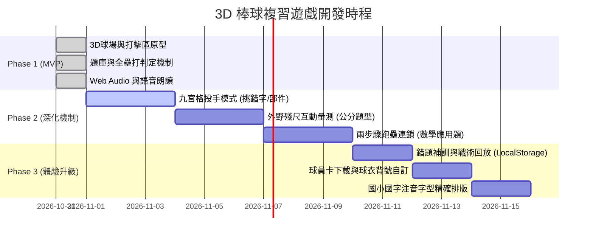

# 國小二年級期中考 3D 棒球複習遊戲：開發計畫書 (Development Plan)

本專案旨在為國小二年級學童（7~8 歲）打造兼具競技快感與深度課業複習的 3D 棒球遊戲，完全託管於 GitHub Pages，支援平板觸控與電腦操作。

---

## 1. 專案範疇與教科書版本鎖定

- **學科 1：國語（康軒版二上）**
  - **範圍**：第 1 ~ 6 課（〈新學年新希望〉至〈小鎮的柿餅節〉）及統整活動一、二。
  - **核心考點**：多音字辨析（得、假、教、空、轉、著、背）、形近字挑錯、日/月/竹/米部部件意義。
- **學科 2：數學（翰林版二上）**
  - **範圍**：第 1 ~ 5 單元。
  - **核心考點**：200 以內的數（三位數化聚、零的讀寫）、二位數直式進退位加減法、公分測量與殘尺非零起點刻度差、加減兩步驟應用題、正方形/長方形幾何特徵。

---

## 2. 系統架構路線圖



---

## 3. 四大開發階段細部里程碑

### 階段一：MVP 基礎打擊循環【已完成 ✅】
- [x] **3D 棒球場渲染**：程式化建立草皮、紅土菱形、四個壘包、投手丘、外野全壘打牆與大記分板。
- [x] **投打對決系統**：投手投球動畫、3 方向車道（左中右）打擊判定、打擊揮棒動作。
- [x] **回饋特效**：全壘打高飛拋物線、金屬球棒音效（Web Audio）、紙花煙火、揮空好球判定。
- [x] **讀題鷹架**：瀏覽器原生中文語音念題（Web Speech API），降低二年級學童識字門檻。
- [x] **雙學科首發題庫**：康軒國語 5 題 + 翰林數學 5 題。
- [x] **GitHub Actions 自動部屬**：代碼推送到 `main` 分支自動更新 GitHub Pages。

---

### 階段二：學科專屬棒球機制深化【進行中 🚧】

#### 2.1 投手防守局：好球帶九宮格投球機 (`PitchingScene`)
- **機制**：攻守交換，學童化身王牌投手站在投手丘。好球帶分割為 3x3 共 9 格板子。
- **學科映射**：
  - **國語挑錯字**：句子中有錯字，九宮格對應正確字，投中正確字直接三振打者！
  - **數學直式加減**：出題 `56 - 29 = ?`，學童需連續投出「個位 7」與「十位 2」，板子被球擊碎！

#### 2.2 外野邊線爭議：3D 殘尺互動量測 (`RulerChallenge`)
- **機制**：擊出邊線滾地球，裁判啟動量測檢視。
- **學科映射（翰林數學第 3 單元）**：
  - 出現一把隨機磨損起點的直尺（例如起點刻度為 4，球停在刻度 11）。
  - 學童在畫面上拖曳伸縮游標量測長度，或拉動刻度滑塊，必須計算 `11 - 4 = 7` 公分並提交，破解非零起點直讀錯誤之迷思。

#### 2.3 盜壘衝刺：兩步驟數學連鎖 (`BaseRunning`)
- **機制**：打出安打後，跑者在壘包間衝刺。
- **學科映射（翰林數學第 4 單元）**：
  - 第一個問題（中間運算量）在跑向二壘時回答，成功滑壘 Safe！
  - 第二個問題（最終答案）在跑向三壘直奔本壘時回答，成功回本壘得分！

---

### 階段三：個人化與家長檢視工具【規劃中 📋】

1. **錯題補訓庫（失誤戰術回放）**：
   - 透過 `localStorage` 記錄答錯題號。
   - 完賽後點擊「進入牛棚特訓」，針對弱點題型（如「假」的讀音、連續退位）重新出題，直到打擊率達到 1.000。
2. **客製化球員卡與背號**：
   - 開局讓學童輸入自己的名字、喜歡的座號/背號，即時渲染於 3D 打者球衣背面。
   - 結算時可使用 HTML Canvas 生成一張圖檔，供家長截圖分享或列印鼓勵。
3. **字型與注音優化**：
   - 導入臺灣教育部楷書與注音直排/旁排相容樣式，確保低年級兒童字形識別規範 100% 正確。

---

### 階段四：測試、驗收與效能標準【規範 🎯】

| 檢驗項目 | 指標與標準 | 驗收方式 |
| :--- | :--- | :--- |
| **首屏載入速度** | 首屏加載時間 $\le 2.0$ 秒（不超過 2MB 資源） | Chrome Lighthouse 性能評分 $\ge 90$ |
| **運行幀率** | iPad / 行動裝置維持在 55 ~ 60 FPS | WebGL 頂點數控制在 10,000 以下，無動態光影計算耗損 |
| **操作易用性** | 觸控按鈕有效點擊區域 $\ge 48 \times 48\text{px}$ | 實機測試 7 歲兒童手指點擊防誤觸 |
| **題庫精準度** | 題目注音、數字計算結果 100% 符合審定本答案 | 自動化單元測試檢查每個 Option isCorrect 唯一性 |

---

## 4. 題庫擴充維護指南

所有新題目只需在 `js/curriculum.js` 的 `CURRICULUM_DATA` 陣列中追加即可，格式如下：
```javascript
{
  id: "chi_06",
  subject: "國語",
  unit: "第六課 小鎮的柿餅節",
  question: "題目文字描述",
  phonetic: "注音輔助",
  options: [
    { text: "選項1", isCorrect: true, hitResult: "全壘打描述" },
    { text: "選項2", isCorrect: false, hitResult: "出局描述" },
    { text: "選項3", isCorrect: false, hitResult: "揮空描述" }
  ],
  hint: "答錯時的引導戰術提示"
}
```
無需修改任何 3D 渲染與物理邏輯，即可實現動態擴充。
