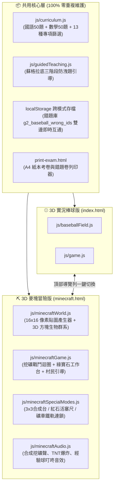

# ⛏️ 國小二年級期中考：3D 麥塊方塊冒險版（Minecraft Edition）開發計畫書

本計畫旨在為專案新增一套平行的 **Minecraft 體素方塊風格（Voxel & Pixel Art）3D 複習遊戲（`minecraft.html`）**，與現有的「⚾ 3D 實況棒球版（`index.html`）」**100% 共用康軒國語 50 題、翰林數學 50 題、蘇格拉底三階段引導教學與跨場次錯題本**，讓喜愛《Minecraft》的二年級學童能透過「挖礦解謎、工作台合成、紅石活塞量尺與屠龍冒險」精熟期中考所有考點。

---

## 1. 核心架構與雙遊戲互通設計

---

## 2. 視覺與 3D 體素引擎設計 (`js/minecraftWorld.js`)

採 **100% 程式化像素貼圖（Procedural 16×16 CanvasTexture + `THREE.NearestFilter`）** 與 `BoxGeometry` 積木建模，不依賴任何外部圖片或 3D 模型檔，確保秒開與 60 FPS 流暢度：

1. **像素方塊材質產生器 (`PixelTextureGenerator`)**：
   - 動態繪製草地方塊（頂部草綠、側面草皮連泥土）、石頭、橡木原木、樹葉、鑽石礦石、黃金礦石、紅石燈、黑曜石與 `TNT` 方塊。
2. **三大生態域與傳奇方塊魔王（依關卡進度動態切換）**：
   - **Stage 1（第 1～3 題｜🌳 主世界綠茵平原 Overworld Day）**：藍天白雲、方塊橡木林，守關魔王為 **🧟 巨型苦力怕＆殭屍隊長（Creeper Boss）**。
   - **Stage 2（第 4～6 題｜🌋 熾熱下界要塞 Nether Crimson）**：暗紅迷霧、熔岩方塊發光地面，守關魔王為 **🔥 烈焰使者王（Blaze Boss，環繞旋轉烈焰棒）**。
   - **Stage 3（第 7～9 題｜🌌 終界黑曜石之巔 The End Night）**：深紫星辰、黑曜石柱與終界水晶，守關魔王為 **🐉 終界黑龍王（Ender Dragon Boss，具翅膀擺動與紫焰氣場）**。
3. **方塊英雄（Steve 鑽石勇者）與互動礦脈**：
   - 玩家角色由方塊頭、身體、四肢組成，右手持 3D 像素工具（木鎬／黃金劍／鑽石鎬／獄髓三叉戟），頭頂或披風即時渲染玩家自訂背號。
   - 畫面正前方生成 **左 `[A]`、中 `[S]`、右 `[D]` 三座發光懸浮礦石方塊**，點擊選項後勇者衝前揮動工具擊碎礦石並發射能量轟擊魔王！

---

## 3. 核心戰鬥與蘇格拉底教學機制 (`js/minecraftGame.js`)

| 遊戲階段 | 麥塊化互動機制 | 教學與回饋設計 |
| :--- | :--- | :--- |
| **出題與瞄準** | **⚡ 紅石充能暴擊槽（Redstone Crit Bar）** | 底部紅石能量游標左右滑動，瞄準中央「🔥 紅石超載區」揮鎬可觸發 **TNT 連鎖暴擊（三倍傷害＋雙倍綠寶石）**。 |
| **答對（成功挖礦）** | **💎 礦石爆裂 ＋ 經驗球飛濺 ＋ 魔王受創** | 方塊碎裂為 3D 像素粒子，播放清脆挖礦聲與升級「叮咚」音效，獲得綠寶石（🟢）並推進關卡。 |
| **第一次答錯** | **🛡️ 盾牌格擋 ＋ 🧙‍♂️ 村莊圖書管理員引導** | **不扣愛心！** 苦力怕發出「嘶嘶～」警告，被誤敲的假礦石變成基岩鎖定；**村民圖書管理員（Villager Librarian）** 彈出三階段蘇格拉底引導（迷思診斷 $\rightarrow$ 關鍵字提問 $\rightarrow$ `【 ❓ 】` 遮罩式合成卷軸），讓學童回礦區重敲正解！ |
| **第二次答錯** | **💥 苦力怕爆炸（扣除 1 顆愛心 ❤️）** | 畫面震動並播放爆炸音效，扣除 1 顆愛心（共 3 顆愛心 ❤️❤️❤️，歸零時觸發「不死圖騰 Totem of Undying」滿血復活），並顯示完整解答與觀念總結。 |

---

## 4. 學科專屬麥塊互動機關 (`js/minecraftSpecialModes.js`)

將原本棒球版的 Phase 2 三大機制，完美轉譯為小學生最熟悉的《Minecraft》機關：

1. **🛠️ 3×3 工作台合成模式（`CraftingTableMode`）**：
   - 點擊快捷列「🛠️ 3×3 合成台」即可開啟經典九宮格工作台！
   - 9 個合成格中包含正確答案方塊與干擾材料方塊（如易混淆字、近似數字），選中正確配方即可合成神劍砍向魔王。
2. **📏 紅石活塞方塊量尺（`RedstonePistonRuler`｜對應翰林數學第 3 單元「公分與斷尺」）**：
   - 遇到斷尺或長度測量題時，自動顯示一排標有刻度的「麥塊草方塊尺」與上方的待測物（如附魔木棍、紅石火把）。
   - 點擊 **「🔴 啟動紅石活塞（一格一格推）」**，紅石活塞會一格一格推出金色方塊並標示 `+1 格（1公分）`，讓孩子直觀數出「從刻度 3 到刻度 9 一共推了 6 個方塊（`9 - 3 = 6`）」！
3. **🛤️ 動力鐵軌礦車兩步驟連鎖（`MinecartRailChain`｜對應翰林數學第 4 單元「兩步驟應用」）**：
   - 遇到兩步驟加減應用題時，畫面浮現「🛤️ 礦車鐵軌兩步驟推進器」：
     - **第一站（中繼動力鐵軌）**：先選出「第一步算式結果」，礦車立刻加速衝過第一站並獎勵 `+10 🟢 綠寶石`！
     - **第二站（終點 TNT 引爆台）**：提示第二步算式方向，引導孩子揮鎬敲出最終答案！

---

## 5. 綠寶石經濟、鍛造商店與道具欄 (Hotbar)

- **底部經典麥塊 9 格快捷欄（Hotbar）與愛心血條**：
  - **道具 1：`🧪 真視藥水`（消耗 20 🟢）**：透視並石化一個錯誤礦石選項（50/50 刪去法）。
  - **道具 2：`🧨 超級 TNT`（消耗 40 🟢）**：本回合必定觸發最高倍率紅石大爆炸！
- **⚒️ 鐵砧神兵鍛造商店（與棒球版金幣或獨立綠寶石存檔相容）**：
  1. `🪵 新手木鎬`（免費）：標準採礦木鎬。
  2. `⚔️ 附魔黃金劍`（60 🟢）：紅石暴擊甜蜜點擴大 50%！
  3. `⛏️ 鑽石神鎬`（120 🟢）：答對保底雙倍暴擊傷害，每題額外 +15 🟢！
  4. `🔱 獄髓雷電三叉戟`（200 🟢）：答對 100% 召喚閃電必殺暴擊，綠寶石獎勵雙倍！
- **🏆 賽後「麥塊屠龍英雄成就卡 (PNG)」下載**：
  - 完賽後以 HTML5 Canvas 繪製像素風成就證書（含選手姓名、編號、屠龍傷害、採礦精準率、所持神兵），支援一鍵下載 PNG。

---

## 6. 檔案新增與修改清單

| 檔案路徑 | 變更類型 | 說明 |
| :--- | :---: | :--- |
| `minecraft.html` | **新增** | 3D 麥塊方塊冒險版主頁面（含頂部生態域魔王資訊、愛心血條、紅石暴擊槽、快捷欄與村民教學視窗） |
| `css/minecraft.css` | **新增** | 麥塊像素風 UI 樣式（立體像素邊框、物品欄 Hotbar、紅石活塞尺、3×3 工作台與動畫） |
| `js/minecraftWorld.js` | **新增** | Three.js 體素世界引擎（16×16 像素貼圖生成、3 大生態域、苦力怕/烈焰使者/終界龍 3D 模型、方塊粒子特效） |
| `js/minecraftAudio.js` | **新增** | Web Audio 麥塊風格合成音效（方塊敲擊聲、經驗球叮咚聲、苦力怕嘶嘶聲、TNT 爆炸聲）＋ 語音朗讀 |
| `js/minecraftSpecialModes.js` | **新增** | 3×3 工作台合成面板、紅石活塞斷尺推進器、礦車鐵軌兩步驟連鎖與麥塊英雄成就卡 Canvas 匯出 |
| `js/minecraftGame.js` | **新增** | 麥塊版主遊戲狀態機，完整對接 `curriculum.js` 與 `guidedTeaching.js` |
| `index.html` | **修改** | 於頂部控制列新增 `⛏️ 切換麥塊版` 快速跳轉按鈕 |
| `scripts/validate-questions.mjs` | **修改** | 擴充驗證腳本，確保棒球版與麥塊版共用模組匯入與狀態無誤 |

---

## 7. 開發與驗收步驟（4 階段無縫交付）

1. **Step 1：建立 3D 體素引擎與音效模組**（`js/minecraftWorld.js`, `js/minecraftAudio.js`）
2. **Step 2：建立麥塊學科專屬機關與成就卡模組**（`js/minecraftSpecialModes.js`）
3. **Step 3：建立麥塊主頁面、像素 UI 與主遊戲迴圈**（`minecraft.html`, `css/minecraft.css`, `js/minecraftGame.js`）並串聯 `index.html` 雙向切換按鈕
4. **Step 4：執行自動化測試與品質檢驗**（`node scripts/validate-questions.mjs`）
