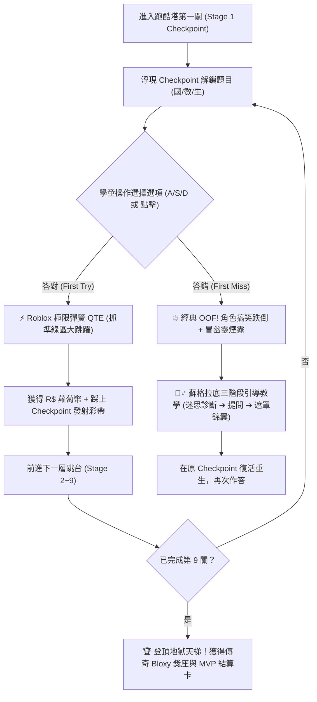

# ROBLOX_PLAN.md

本文件規範「國小二年級期中考複習：3D Roblox 風格障礙闖關版（Roblox Obby Edition）」之核心架構、視覺規範、學科題庫融合機制、獨立數據儲存與實作里程碑。

---

## 1. 專案核心定位與目標

- **名稱**：國小二年級期中考：3D 羅布樂思極限障礙跑酷（Roblox Obby Adventure）
- **獨立入口**：`roblox.html`（與棒球版 `index.html`、麥塊版 `minecraft.html` 並存，獨立運作）
- **核心體驗**：
  - 汲取 Roblox 最受小學童歡迎的 **「Obby（Obstacle Course 障礙跑酷闖關）」** 與 **「Tower of Hell（地獄之塔攀爬）」** 機制。
  - 將 9 題期中考題轉化為 **9 座懸浮霓虹平台（Checkpoint Pads）**。
  - 答對題目觸發「雷射柵欄解鎖」、「彩虹雲朵橋延伸」或「黃金重力彈簧（Gravity Coil）大跳躍」推進下一關。
  - 答錯時觸發經典搞笑的 **「OOF! 幽靈碎裂動畫」**，並無縫銜接蘇格拉底引導教學，回到當前 Checkpoint 重試。
  - 結合 Roblox 的 **Blox 虛擬幣（R$）經濟**，可於商店購買 Bloxy Cola（跑速加倍）、重力彈簧圈（超高跳躍）、霓虹光環（Halo）與寵物跟隨器。

---

## 2. 視覺風格與 3D 渲染規格（Three.js）

### 2.1 經典 Roblox 塑膠積木美學（Smooth Plastic Aesthetic）
- **材質特性**：
  - 放棄 Minecraft 的 16x16 像素馬賽克，改採 Roblox 標誌性的 **「亮面高反光塑膠材質（MeshStandardMaterial，roughness: 0.18, metalness: 0.05）」**。
  - 跳台邊緣採用 **自發光霓虹材質（MeshBasicMaterial 或 emissive: 0.8）**，營造鮮豔的賽博龐克／遊樂園氛圍。
- **3D 經典角色（Robloxian Noob / Bacon Avatar）**：
  - 由標準 6 大積木塊組成：黃色頭部（帶經典笑臉）、藍色軀幹、青綠色雙腳、黃色雙手。
  - 支援外觀客製：培根頭（Bacon Hair）、紅帽子、天使霓虹光環。
- **關卡場景建構**：
  - 垂直螺旋向上的「天梯障礙跑酷塔（The Floating Obby Tower）」。
  - 經典障礙物實體：
    1. **紅光致命雷射線（Lava Jump Spikes）**：答對時自動升降關閉。
    2. **彩虹透明玻璃方塊（Rainbow Glass Steps）**：答對時自動亮起顯形。
    3. **旋轉風車推桿（Rotating Sweepers）**：在等待答題時於外圍緩慢旋轉。
    4. **重生 Checkpoint 光圈底座**：圓形帶白邊霓虹底座，踏上後轉為綠光並發射彩帶。

---

## 3. 遊戲機制與學科融合深度設計

### 3.1 跑酷流程與生命週期



### 3.2 學科專屬 Roblox 互動機關

1. **數學第 3 單元（斷尺非零起點）➔ 霓虹雷射尺跑道（Laser Beam Tape Measure）**：
   - 跑道化為半透明標尺，起點與終點由兩道雷射感應門標示，學童必須計算出正確公分長度才能關閉雷射通關。
2. **數學第 4 單元（兩步驟加減應用題）➔ 雙重彈簧跳床（Double Bouncy Trampoline）**：
   - 第一步驟答對，角色踩上第一座彈簧墊騰空躍起並獲得第一階段數字（+10 R$）；
   - 第二步驟答對，在空中踩中第二座彈簧直衝終點平台。
3. **生活科第 2 單元（光與影子）➔ Roblox 探照燈暗影迷宮（Searchlight Shadow Maze）**：
   - 切換東方朝陽、正午頭頂、西方夕陽的探照燈角度，觀察積木人的陰影投射方向，解鎖對應影長謎題。
4. **國語多音字與部首 ➔ 霓虹跳舞機方塊（Neon Dancing Floor）**：
   - 地面化為 3 塊發光的跳舞積木，選中正確讀音或部首，該方塊發出清脆咚咚聲並將角色彈射向上。

---

## 4. 獨立資料庫與經濟循環設計

Roblox 版全面採用獨立 `localStorage` 前綴 **`g2_roblox_*`**，確保與棒球版與麥塊版 100% 隔離：

| Key 名稱 | 預設值 | 說明 |
| :--- | :--- | :--- |
| `g2_roblox_coins` | `0` | Blox 虛擬幣（R$ 蘿蔔幣），答對與過關賺取 |
| `g2_roblox_unlocked_gears` | `["gravity_coil"]` | 已解鎖的 Roblox 道具（Bloxy Cola, Speed Coil 等） |
| `g2_roblox_equipped_gear` | `"gravity_coil"` | 目前手持裝備之道具 |
| `g2_roblox_unlocked_pets` | `["doge"]` | 已解鎖的 3D 浮空隨身寵物（Doge, Bloxy Cat 等） |
| `g2_roblox_equipped_pet` | `"doge"` | 目前出戰寵物 |
| `g2_roblox_player_name` | `"極限跑酷王"` | 玩家姓名 |
| `g2_roblox_avatar_skin` | `"classic_noob"` | 角色造型（經典 Noob、培根男孩、粉紅龐克） |
| `g2_roblox_wrong_ids` | `[]` | 專屬錯題地牢記錄 |
| `g2_roblox_seen_ids` | `[]` | 智慧抽題歷史 |

---

## 5. Web Audio 經典合成音效規格

由獨立的 `js/robloxAudio.js` 透過 Web Audio API 純程式合成（免下載 external MP3，零載入延遲）：

1. **經典 "OOF!" 跌倒音效**：
   - 短暫的雙振盪器滑音（Pitch Drop 260Hz $\rightarrow$ 140Hz），帶有圓潤的 Triangle 波形與急促的 Exponential Decay。
2. **重力彈簧跳躍聲（Coil Boing）**：
   - 高頻正弦波上滑（400Hz $\rightarrow$ 880Hz）加上 LFO 顫音調變（Modulation），模擬彈簧金屬回音。
3. **雷射通行嗶嗶聲（Checkpoint Beep）**：
   - 雙方波琶音（523Hz C5 $\rightarrow$ 659Hz E5 $\rightarrow$ 783Hz G5），明亮清脆。
4. **Bloxy 勝利號角（Victory Fanfare）**：
   - 合成 Roblox 遊戲勝利時的歡呼短旋律。

---

## 6. 專案架構擴充與檔案對照

```text
grade2-sem1-midterm-review/
├── index.html                  # [棒球版] 3D 實況滿貫王 5.0 (g2_baseball_*)
├── minecraft.html              # [麥塊版] 3D 麥塊大冒險・終界屠龍篇 (g2_mc_*)
├── roblox.html                 # [新增: 羅布版] 3D Roblox 極限跑酷篇 (g2_roblox_*)
├── print-exam.html             # A4 紙本模擬考卷、三大版本錯題卷與弱點雷達
├── css/
│   ├── style.css               # 棒球版樣式
│   ├── minecraft.css           # 麥塊版像素樣式
│   └── roblox.css              # [新增: 羅布版] 亮面霓虹 UI、R$ 幣、跑酷血條與商店樣式
├── js/
│   ├── robloxGame.js           # [新增: 羅布版] 主遊戲狀態機與獨立存檔
│   ├── robloxWorld.js          # [新增: 羅布版] Three.js 3D 霓虹天梯跑酷塔與積木人
│   ├── robloxSpecialModes.js   # [新增: 羅布版] 雷射尺跑道、雙重彈簧跳、探照燈暗影迷宮
│   ├── robloxAudio.js          # [新增: 羅布版] OOF!、彈簧、雷射與勝利合成音效
│   ├── gameLogic.js            # [共用] 純規則運算
│   ├── gameplayUpgrades.js     # [共用] QTE、肉鴿天賦、飛天靶心與盲盒
│   ├── curriculum.js           # [共用] 150 題題庫與 18 專項篩選
│   └── guidedTeaching.js       # [共用] 蘇格拉底三階段引導教學
```

---

## 7. 實作計畫里程碑（Milestones）

| 階段 | 工項 | 目標與驗收標準 | 狀態 |
| :--- | :--- | :--- | :--- |
| **M1** | 核心 3D 場景與跑酷世界 (`robloxWorld.js`, `roblox.css`, `roblox.html`) | 建立霓虹懸浮天梯跳台、Checkpoint 發光底座、積木人 Noob 3D 模型與跳躍動畫。 | ✅ 已完成 |
| **M2** | 獨立遊戲狀態機與音效 (`robloxGame.js`, `robloxAudio.js`) | 串接 150 題題庫、經典 "OOF!" 失敗與復活重生、答對雷射門開啟。 | ✅ 已完成 |
| **M3** | 學科機關與 QTE 升級 (`robloxSpecialModes.js`) | 整合雷射斷尺、兩步驟雙彈簧跳、探照燈光影迷宮與手動彈簧跳躍 QTE。 | ✅ 已完成 |
| **M4** | R$ 商店、寵物與道具系統 | 支援 Bloxy Cola、重力彈簧圈裝備與 3D 浮空寵物伴隨。 | ✅ 已完成 |
| **M5** | 整合驗證、PWA 快取與自動化測試 | 更新 `sw.js`、`manifest.json`、`README.md`、`AGENTS.md`，並通過 `validate-questions.mjs`。 | ✅ 已完成 |
